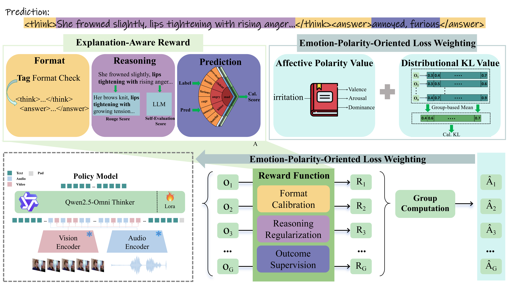
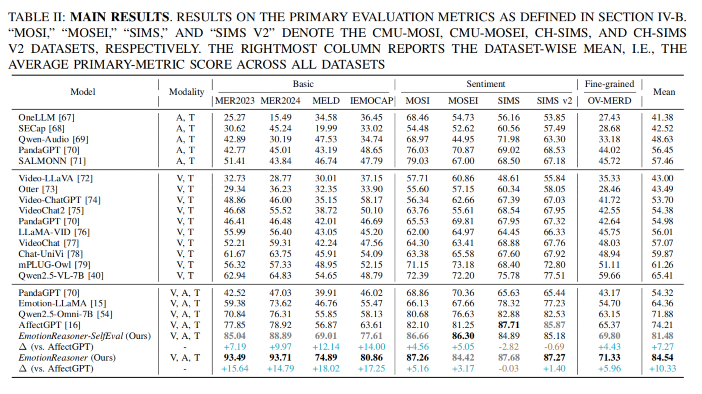
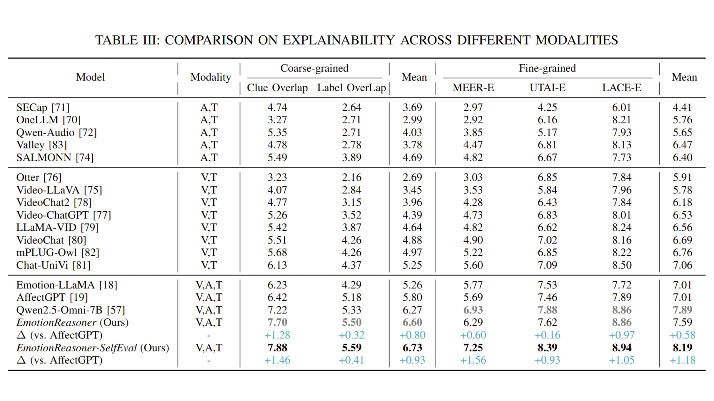
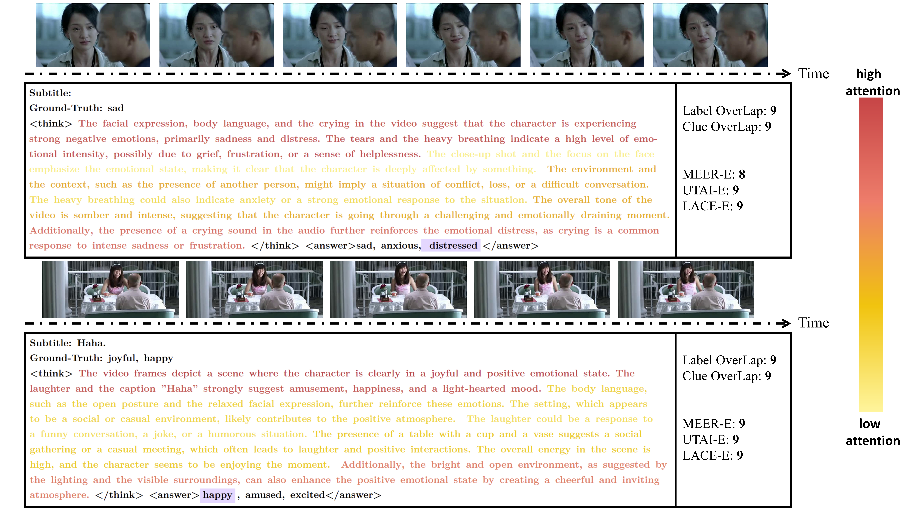

# EmotionReasoner: Emotion-Explanation-Oriented Reinforcement Learning for Explainable Multimodal Emotion Recognition

Multimodal emotion recognition (MER) aims to identify emotional cues from multimodal inputs such as text and vision. With the rise of multimodal large language models (MLLMs), research has shifted toward explainable multimodal emotion recognition (EMER), which seeks not only accurate emotion prediction but also transparent reasoning. However, existing reinforcement learning (RL)-based methods often generate verbose and unfocused explanations, and current evaluation protocols remain coarse-grained.

To address these issues, we propose an RL-based optimization framework that integrates an explanation-aware reward and an emotion-polarity-oriented loss weighting strategy. The reward jointly considers structural validity, prediction correctness, and explanation quality, while the weighting mechanism emphasizes emotionally salient tokens to encourage emotion-centric reasoning. In addition, we introduce three complementary evaluation metrics—MEER-E, LACE-E, and UTAI-E—to provide a more fine-grained assessment of explanation fidelity, logical coherence, and practical utility. Extensive experiments demonstrate that the proposed framework improves both emotion recognition performance and explanation quality across multiple datasets.

---

## 📌 Overview

EmotionReasoner introduces a reasoning-enhanced learning framework to:

- We propose EmotionReasoner, an emotion-polarity-oriented RL framework that leverages explanation-aware rewards and emotion-polarity–guided token weighting to incentivize both emotion recognition and explanation. 
- Augmenting existing EMER evaluation frameworks, three complementary metrics—UTAI-E, LACE-E, and MEER-E—are introduced to rigorously evaluate finer-grained explanation quality on practical utility, logical clarity, and fidelity to multimodal cues. 
- Extensive experiments conducted on the MER-UniBench, which encompasses nine representative datasets, demonstrate that the proposed method achieves state-of-the-art average performance in MER, while additional evaluations further confirm its superiority in EMER. 

The framework integrates reinforcement learning (GRPO-based optimization), structured reward design, and model-driven self-evaluation to enhance reasoning quality.

---
## 🏗 Framework Architecture

EmotionReasoner consists of the following core components:

---

### General Checkpoints
| Model Name     | Model Type |
|:----------------|:------------:|
| [Qwen2.5-Omni-7B](https://www.modelscope.cn/models/qwen/Qwen2.5-7B)  | Base Model |


### EmotionReasoner Checkpoints
| Model Name     | Model Type |
|:----------------|:------------:|
| [EmotionReasoner](https://www.modelscope.cn/models/SmilingWeeping/EmotionReasoner)  | Training on **MERCaption+** |
| [EmotionReasoner-SelfEval](https://www.modelscope.cn/models/SmilingWeeping/EmotionReasoner)  | Training on **MERCaption+** |


## 📊 Experimental Results

EmotionReasoner is evaluated on:
- Basic Emotion Recognition **MER2023 MER2024 MELD IEMOCAP**
- Sentiment Emotion Recognition **CMU-MOSI CMU-MOSEI CH-SIMS CH-SIMS-v2**
- Fine-grained Emotion Recognition **OV-MERD**


- Explanation Metric:


- Sentence-level attention visualization :

---

## ⚙️ Installation

```bash
conda create -n emotionreasoner python=3.10
conda activate emotionreasoner

pip install -r requirements.txt

# Download the checkpoint
git clone https://www.modelscope.cn/SmilingWeeping/EmotionReasoner.git
```

## Evaluation
```bash
# You can choose from datasets (MER2023, MER2024, MELD, IEMOCAP, CMU-MOSI, CMU-MOSEI, CH-SIMS, CH-SIMS-v2, OV-MERD)
# Inference and Storing Results
python main.py evaluate_affectgpt --dataset='CMU-MOSEI'
# Calculating metrics
export VLLM_WORKER_MULTIPROC_METHOD=spawn
python main.py calculate_metrics --model='qwen_omni_rl'

# or
./bash/eval_emotionreasoner.sh
```

```bash
# eval-type can choose from (OverLap, Ours), the default dataset is OV-MERD
python main.py calculate_overlap_score --eval_type='Ours'
```
